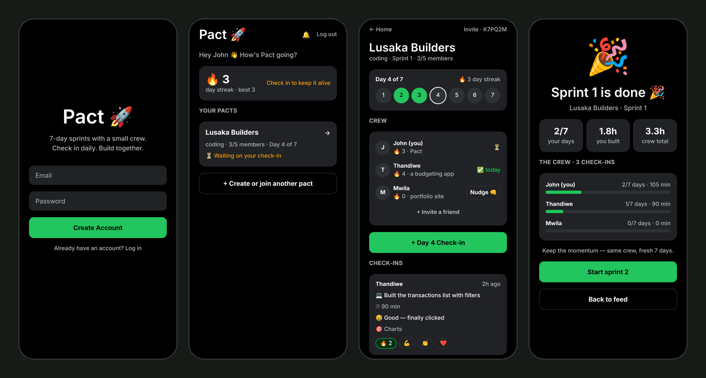
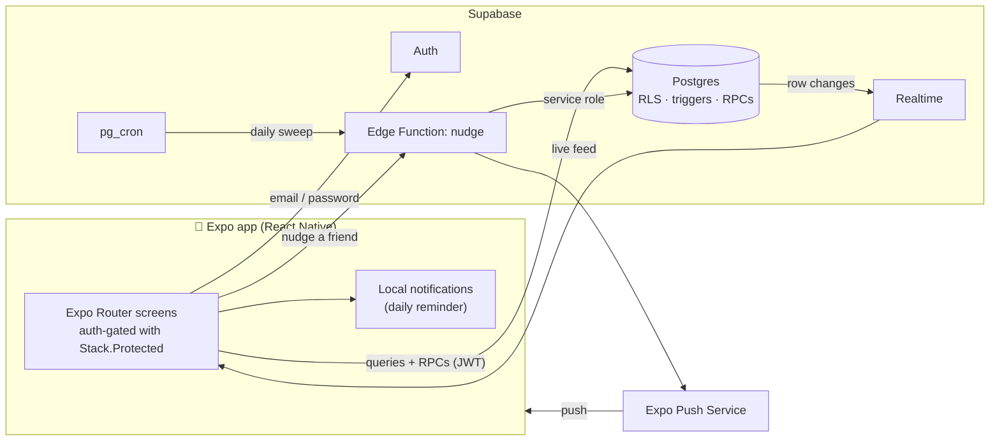

<p align="center">
  
</p>

<h1 align="center">Pact</h1>

<p align="center">
  <strong>7-day accountability sprints for small groups of developers.</strong><br />
  Check in daily, keep your streak alive, and build alongside friends who show up.
</p>

<p align="center">
  <a href="https://github.com/john-chola/pact/actions/workflows/ci.yml"></a>
  
  
  
  
</p>



## Why

Building alone is hard to sustain, and big communities are too noisy to keep you accountable. Pact puts you in a crew of **at most five people** for a **7-day sprint**. Each day everyone posts a short, honest check-in: what they worked on, for how long, how it felt, and what's next. Streaks, reactions and nudges keep the group moving, and when the sprint ends you start the next one together.

The idea came from a WhatsApp accountability experiment. Pact turns it into a product.

## Features

- **Email auth + onboarding:** name, what you're building, and your goal.
- **Pacts (groups):** create one and share a 6-character invite code, or join with a code. Capped at 5 members.
- **Daily check-in:** what you worked on, time spent, honest feeling, tomorrow's plan. One per day per pact.
- **Live group feed:** new check-ins and reactions appear instantly through Supabase Realtime.
- **Streaks:** per pact and overall, with your best streak.
- **Sprint tracker:** "Day 4 of 7" progress dots, a results screen and a one-tap "Start sprint 2".
- **Reactions:** 🔥 💪 👏 ❤️ on any check-in.
- **Reminders and nudges:** a local daily reminder at the time you pick, a "Nudge 👊" button for quiet friends, and an automatic daily nudge for anyone who missed yesterday.
- **Light and dark mode** throughout.

## Architecture



There is no custom API server. The client talks to Postgres directly, and **the database enforces every rule**, so a modified client can't cheat.

| Concern | Where it lives |
| --- | --- |
| Who can read what | Row Level Security. You only see groups you belong to and profiles of people you share a group with. Push tokens are private. |
| Group rules | `security definer` RPCs: `create_group`, `join_group_by_code` (5-member cap, row lock against races), `start_new_sprint`, `leave_group` |
| One check-in per day, date sanity | `BEFORE INSERT` trigger on `checkins` |
| Streaks | `AFTER INSERT` trigger. Clients have no `UPDATE` grant on streak columns, so streaks can't be faked. |
| Timezones | Clients send their **local** calendar date. The server accepts ±1 day around UTC. |
| Nudges | Deno Edge Function using the service role, with a 12-hour cooldown per person |

### Engineering decisions

- **Logic in Postgres, not an Express server.** The original plan had a Node/Express API on Railway. Moving the rules into RLS, triggers and RPCs removed a whole service to deploy, secure and pay for, and keeps the rules in one place.
- **Realtime as an invalidation signal.** A pact has at most 5 members, so on any change the feed simply re-fetches (debounced 300 ms) instead of merging patches. It's always correct, cheap at this scale, and handles deletes that Realtime filters can't target.
- **Declarative auth routing.** `Stack.Protected` guards switch between sign-in, onboarding and the app based on session and profile state, so there are no imperative redirects to get out of sync.
- **Idempotent migration.** `schema.sql` can be re-run safely on a live project. It adds missing columns, de-duplicates legacy memberships and backfills profiles.

## Testing

| Suite | What it covers | Command |
| --- | --- | --- |
| Unit | Date, streak and sprint logic: month, year and leap-year boundaries, streak expiry, "quiet member" rules | `npm test` |
| Component | `Button` / `Chip` behaviour and accessibility, sign-in validation and Supabase calls (mocked) | `npm test` |
| Database | ~30 assertions against a real Postgres: RLS isolation, 5-member cap, duplicate and back-dated check-ins, spoofed `user_id`, streak maths, reactions, sprint restarts, private push tokens | `npm run test:db` |

CI ([`.github/workflows/ci.yml`](.github/workflows/ci.yml)) runs the typecheck, ESLint and Jest, and the database suite against a Postgres 16 service container on every push and pull request.

```bash
npm run check     # typecheck + lint + unit/component tests
npm run test:db   # needs a local Postgres (uses the PG* env vars)
```

## Tech stack

**App:** Expo SDK 56, React Native 0.85, React 19 (React Compiler), Expo Router (typed routes), TypeScript (strict), Reanimated, expo-notifications, expo-secure-store
**Backend:** Supabase (Postgres 16, Auth, Realtime, Edge Functions on Deno, pg_cron)
**Quality:** Jest + jest-expo, React Native Testing Library, ESLint (eslint-config-expo), GitHub Actions
**Delivery:** EAS Build / Submit

## Project layout

```
src/app/                       Screens (file-based routes)
  _layout.tsx                  Auth gate: sign-in → onboarding → app
  sign-in.tsx, onboarding.tsx
  index.tsx                    Home: streak + your pacts
  groups.tsx                   Create / join a pact
  feed/[groupId].tsx           Sprint tracker, crew, check-in form, feed, reactions
  sprint-complete/[groupId].tsx
  notifications.tsx            Daily reminder settings
src/components/ui.tsx          Themed UI kit (Screen, Button, Input, Chip, Card…)
src/lib/                       Supabase client, auth context, date logic, notifications
supabase/schema.sql            Tables, RLS, RPCs, triggers, realtime
supabase/functions/nudge/      Edge Function for push nudges
supabase/cron.sql              Daily nudge schedule
supabase/tests/                Database behaviour tests
```

## Running it yourself

### 1. App

```bash
npm install
cp .env.example .env   # Supabase URL + publishable key
npx expo start
```

Notifications need a **development build** on a real phone (`eas build --profile development`); they don't work in Expo Go.

### 2. Database

In the Supabase dashboard open **SQL Editor → New query**, paste [`supabase/schema.sql`](supabase/schema.sql) and run it. Re-run it whenever the file changes.

### 3. Push nudges (optional)

```bash
supabase link --project-ref <your-project-ref>
supabase functions deploy nudge --no-verify-jwt
supabase secrets set NUDGE_CRON_SECRET=$(openssl rand -hex 24)
```

Then:

1. Enable the `pg_cron` and `pg_net` extensions, fill in [`supabase/cron.sql`](supabase/cron.sql) and run it.
2. Android push needs Firebase: add `google-services.json`, set `android.googleServicesFile` in `app.json`, and upload the FCM key with `eas credentials`.

### 4. Ship

```bash
eas build --profile preview --platform android   # installable APK for testers
eas build --profile production --platform all
eas submit --platform android                     # Play Console
eas submit --platform ios                         # TestFlight
```

## Roadmap

- [x] Auth, onboarding, navigation, schema
- [x] Pacts, check-ins, realtime feed, streaks
- [x] Reminders, nudges, sprint results, reactions, light/dark UI
- [x] Tests (unit, component, database) and CI
- [ ] Beta with the original WhatsApp accountability group
- [ ] Play Store / TestFlight release

Deliberately out of scope for v1: direct messages, discovery feed, public profiles, leaderboards, payments.

## License

[MIT](LICENSE)
